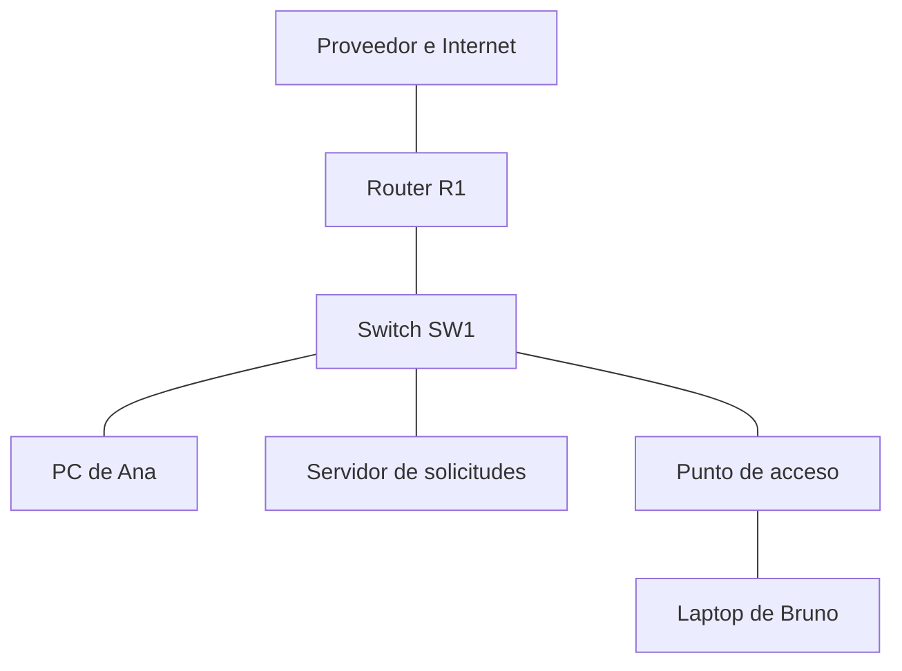

# CCNA S001 — Qué es una red

**Fecha de estudio prevista:** 14 de octubre de 2026, 09:00, UTC−6.  
**Nivel:** desde cero.  
**Curso:** preparación para 200-301 CCNA v2.0.  
**Tiempo recomendado:** 25–30 minutos de lectura y explicación; completar después la práctica S001. La sesión completa requiere aproximadamente 75 minutos.  
**Prerrequisitos:** ninguno.  
**Relación con el temario:** fundamentos para el diagnóstico de clientes y de conectividad, objetivos 1.6 y 2.4. Esta primera clase no agota esos objetivos.

## 1. Qué podrás hacer al terminar

- Explicar qué necesita una red para permitir una comunicación.
- Reconocer clientes, servidores, switches, routers y puntos de acceso.
- Distinguir conexión local, comunicación entre redes y acceso a Internet.
- Identificar dirección IP, máscara y puerta de enlace en una configuración.
- Describir una falla con hechos observables, sin adivinar su causa.

La meta de hoy es que puedas mirar una oficina con computadoras, cables y Wi-Fi y explicar qué función cumple cada pieza. Los cálculos de subredes y la configuración de routers llegarán después de construir esta base.

## 2. Un problema concreto: compartir una aplicación

Imagina **Campus Aurora**, una empresa ficticia. Ana registra solicitudes desde su computadora. Bruno revisa esas solicitudes desde otra. Una tercera computadora ejecuta la aplicación y conserva los datos.

Para que el trabajo funcione, deben poder intercambiar información. Esa comunicación necesita:

1. **Participantes:** los equipos y programas que envían o reciben información.
2. **Un medio:** por ejemplo, un cable o una conexión de radio.
3. **Interfaces:** los puntos por los que cada equipo se conecta al medio.
4. **Reglas compartidas:** los protocolos que permiten interpretar los mensajes.
5. **Direccionamiento:** una forma de identificar hacia dónde enviar la comunicación.

Una **red de computadoras** es un conjunto de dispositivos conectados que pueden intercambiar información usando reglas compatibles. La red sirve para compartir aplicaciones, archivos, impresoras, sensores y muchos otros servicios. [1]

No basta con que dos aparatos tengan un cable conectado: también deben tener una configuración compatible y los servicios necesarios disponibles. Durante el curso aprenderás a comprobar cada condición por separado.

### Piensa antes de continuar

Si Ana puede abrir la aplicación y Bruno no, ¿qué dato te conviene obtener primero?

Una buena primera pregunta es: “¿Qué funciona y qué falla exactamente desde cada equipo?”. Decir “se cayó toda la red” sería una conclusión demasiado amplia para la evidencia disponible.

## 3. Los equipos y sus funciones

| Elemento | Función inicial que debes reconocer | Ejemplo en Campus Aurora |
| --- | --- | --- |
| Host o dispositivo final | Origina o recibe una comunicación | PC de Ana, impresora, teléfono IP |
| Cliente | Programa que solicita un servicio | Navegador que solicita una página |
| Servidor | Programa o equipo que ofrece un servicio | Aplicación de solicitudes |
| Switch de capa 2 | Conecta dispositivos de una LAN y conmuta tramas Ethernet | Switch al que llegan las PCs |
| Router | Reenvía paquetes entre redes IP | Equipo que conecta oficina y sucursal |
| Punto de acceso o AP | Integra clientes inalámbricos con la red | Equipo Wi-Fi de la sala |
| Firewall | Aplica reglas que permiten o bloquean tráfico | Control de acceso entre segmentos |

Una misma caja puede tener varias funciones. El equipo doméstico llamado “router Wi-Fi” suele combinar funciones de router, switch y punto de acceso. En una empresa puedes encontrar esas funciones en dispositivos separados. [2][3]

“Cliente” y “servidor” también describen **roles de programas**. Una computadora puede usar un navegador como cliente y, al mismo tiempo, ejecutar un servicio para otros equipos. El rol depende de la comunicación que estés analizando.

### Switch y router: primera aproximación

En la LAN de Ana y Bruno, el switch permite intercambiar tramas entre equipos. Cuando la comunicación debe llegar a otra red IP, interviene una función de enrutamiento. Más adelante verás que un switch de capa 3 también puede realizarla. [4]

Hoy conserva esta idea: **conectar dispositivos a una LAN** y **conectar redes IP** son funciones diferentes. El nombre comercial del aparato no basta para deducir todas sus capacidades.

## 4. LAN, WAN e Internet

Una **LAN**, o red de área local, conecta dispositivos en un entorno local, como una oficina. Una **WAN** permite interconectar ubicaciones más amplias, por ejemplo varias sedes. **Internet** conecta redes de numerosas organizaciones y proveedores. [1][5]

Una oficina puede tener una aplicación y una impresora que funcionen localmente aunque se pierda el enlace hacia el proveedor de Internet. Esto será útil para delimitar incidentes.

En este dibujo, las líneas indican conexiones, no resultados de pruebas ni rutas verificadas:



Lee el dibujo así:

1. Ana entra por una conexión cableada al switch.
2. Bruno entra por el punto de acceso, que conecta con el switch.
3. El servidor de solicitudes tiene una conexión local al switch.
4. R1 permite alcanzar otras redes, si dispone de configuración y conectividad adecuadas.

Si Ana y el servidor están en la misma subred y VLAN del escenario, su tráfico local no necesita salir a Internet. En futuras clases analizaremos cómo identifica Ana el destino local y cómo aprende las direcciones necesarias.

## 5. Tres datos que empezarás a reconocer

Considera esta configuración ficticia:

| Campo | Valor | Interpretación inicial |
| --- | --- | --- |
| Dirección IPv4 | `192.168.10.20` | Dirección asignada a una interfaz |
| Máscara de subred | `255.255.255.0` | Delimita la parte de red de la dirección |
| Puerta de enlace predeterminada | `192.168.10.1` | Siguiente salto habitual para destinos sin una ruta más específica |

La dirección IP no identifica una persona. La máscara permite decidir si un destino pertenece a la misma subred. La puerta de enlace suele ser una interfaz de un router o una función de capa 3 del segmento.

En este ejemplo concreto, con esa máscara, `192.168.10.20` y `192.168.10.30` pertenecen a la misma subred. `192.168.20.30` pertenece a otra. Esto se debe a **esa máscara**; no es una regla universal basada en comparar siempre los primeros tres números. Aprenderás el cálculo en las semanas 3 y 4.

La existencia de una puerta de enlace configurada tampoco demuestra que sea alcanzable. La configuración describe lo que el equipo intentará usar; una prueba permite observar si funciona.

### IP y MAC

Hoy basta con reconocer que son direcciones distintas. La dirección MAC se utiliza en el funcionamiento de Ethernet local; la IP se utiliza para la comunicación IP y el enrutamiento. No necesitan tener el mismo formato ni significan lo mismo. [4]

## 6. Protocolos: reglas con responsabilidades distintas

Un **protocolo** define reglas para intercambiar información: formatos, mensajes y comportamientos esperados. En una comunicación suelen colaborar varios protocolos.

Para esta primera clase, piensa en capas de responsabilidades:

- Un mecanismo permite transmitir información por un enlace.
- Otro permite direccionar y transportar información entre redes.
- Otros permiten que los programas utilicen servicios.

Por ejemplo, abrir una aplicación no es una única operación indivisible. Puede requerir resolver un nombre, alcanzar un servidor y completar una conversación con el servicio. En las próximas sesiones asignaremos nombres precisos a cada parte.

Tu experiencia en software será útil: una aplicación puede estar bien escrita y fallar porque no alcanza su servidor; también puede existir conectividad IP y fallar la aplicación. El diagnóstico consiste en encontrar **qué parte dejó de cumplir su función**.

## 7. Primera observación desde Windows

Abre Símbolo del sistema o una terminal y ejecuta:

```text
ipconfig
```

Este comando muestra parámetros de los adaptadores. Busca la interfaz que realmente utilizas, porque puedes ver Ethernet, Wi-Fi y adaptadores virtuales. Identifica IPv4, máscara y puerta de enlace; en una interfaz desconectada pueden no aparecer los mismos datos. [6]

Para consultar detalles adicionales existe:

```text
ipconfig /all
```

No necesitas interpretar hoy cada campo. La práctica te pedirá localizar solo los que ya conoces.

También puedes observar una prueba local:

```text
ping 127.0.0.1
```

`127.0.0.1` es una dirección de loopback: la prueba se dirige al propio equipo. Un resultado correcto por sí solo no demuestra que el cable, el Wi-Fi, el router o Internet funcionen. [7]

En general, `ping` intercambia mensajes ICMP de eco y muestra respuestas o fallas de esa prueba. Una respuesta aporta evidencia de alcance IP e intercambio de esos mensajes, no de que toda aplicación esté funcionando. Una ausencia de respuesta requiere investigar; puede haber pérdida de conectividad o filtrado. [8]

## 8. Diagnosticar sin inventar causas

Supón estas observaciones ficticias:

- Ana puede utilizar la impresora local.
- Ana no puede abrir una página externa.
- Bruno tiene el mismo problema con esa página.

La evidencia sugiere que al menos parte de la comunicación local funciona. Todavía faltan datos para atribuir la causa al proveedor, DNS, firewall o servidor remoto.

Una respuesta profesional sería:

> La impresión local funciona desde Ana. La página externa falla desde dos clientes. Voy a comparar el alcance del gateway y de otros servicios, y después separaré resolución de nombres de acceso al destino.

Observa la estructura: **hecho → alcance → siguiente prueba**. La usaremos durante todo el curso.

## 9. Vocabulario de examen

| Inglés | Español | Frase breve de práctica |
| --- | --- | --- |
| Network | Red | A network connects devices. |
| Host | Dispositivo final | This host needs a valid IP address. |
| Interface | Interfaz | Check the active interface. |
| Link | Enlace | The link connects two devices. |
| Switch | Conmutador | The switch connects the office devices. |
| Router | Enrutador | The router forwards packets between networks. |
| Default gateway | Puerta de enlace predeterminada | Check the default gateway. |
| Reachability | Alcanzabilidad | We need to test IP reachability. |
| Evidence | Evidencia | Record the evidence before changing anything. |
| Troubleshooting | Diagnóstico y resolución de fallas | Start by defining the symptom. |

No necesitas memorizar todas las frases hoy. Intenta explicar en voz alta la función de switch y router usando una frase en español y una en inglés.

## 10. Comprueba tu comprensión

Responde sin mirar la tabla de funciones. Las respuestas y su razonamiento están al final de la práctica S001.

1. ¿Para qué sirve una red en Campus Aurora?
2. ¿Qué diferencia existe entre un cliente y un servidor?
3. ¿Qué función conecta redes IP diferentes?
4. ¿Puede seguir funcionando una impresora local si falla Internet? Explica las condiciones del escenario.
5. ¿Qué indica la máscara de subred?
6. ¿Un `ping` exitoso a `127.0.0.1` prueba que Internet funciona?
7. Si un equipo no recibe respuesta de `ping`, ¿puedes afirmar que el destino está apagado? ¿Por qué?
8. **Which device forwards packets between different IP networks?** Explica la respuesta en español y reconoce las palabras clave.

## 11. Qué entregar de esta sesión

Completa el archivo `CCNA_S001_Practica_Observar_y_describir_una_red.md`. Comparte aquí tus respuestas numeradas, la pequeña tabla de configuración y un diagnóstico de tres frases. Si usas datos propios, puedes reemplazar los nombres de equipos por nombres ficticios.

### Lista de verificación

- [ ] Explico la finalidad de una red con mis palabras.
- [ ] Distingo switch, router y punto de acceso.
- [ ] Distingo LAN e Internet.
- [ ] Reconozco IPv4, máscara y gateway en un ejemplo.
- [ ] Explico una limitación de `ping`.
- [ ] Distingo observación de hipótesis.

Si todavía confundes dos funciones, vuelve a dibujar el recorrido de Ana al servidor y de Ana a un destino externo. Ese contraste será más útil que memorizar definiciones sin un caso.

**Siguiente sesión:** bits, bytes, velocidad, latencia y pérdida. Entenderás por qué “el enlace está activo” y “la aplicación responde bien” son observaciones diferentes.

## Fuentes y alcance

Consultadas el 13 de octubre de 2026. Campus Aurora, su direccionamiento y sus incidentes son ejemplos originales ficticios. Las referencias permiten ampliar los conceptos; no necesitas leerlas todas para completar esta clase.

1. [Cisco: redes de computadoras](https://www.cisco.com/site/us/en/learn/topics/networking/what-is-computer-networking.html).
2. [Cisco: fundamentos de redes](https://www.cisco.com/site/us/en/learn/topics/small-business/networking-basics.html).
3. [Cisco: glosario de equipos y redes](https://www.cisco.com/c/en/us/support/docs/smb/routers/cisco-rv-series-small-business-routers/kmgmt-1080-New-to-Cisco-Business-General-Glossary.html).
4. [Cisco: conmutación de redes](https://www.cisco.com/site/us/en/learn/topics/networking/what-is-network-switching.html).
5. [Cisco: red de área local](https://www.cisco.com/site/us/en/learn/topics/networking/what-is-a-lan-local-area-network.html).
6. [Microsoft: ipconfig](https://learn.microsoft.com/es-es/windows-server/administration/windows-commands/ipconfig).
7. [Microsoft: comprobación del adaptador](https://learn.microsoft.com/es-es/troubleshoot/windows-client/networking/ping-exe-check-microsoft-broadband-network-adapter).
8. [Microsoft: ping](https://learn.microsoft.com/es-es/windows-server/administration/windows-commands/ping).

---

Fin de la lección S001.
